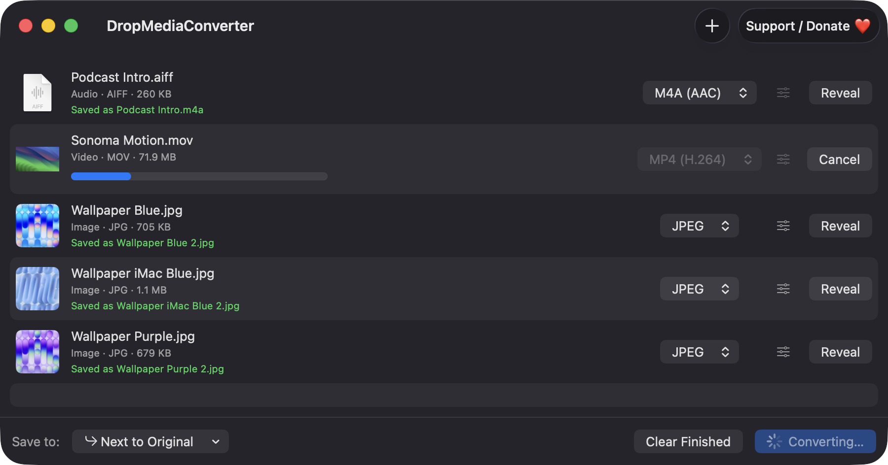
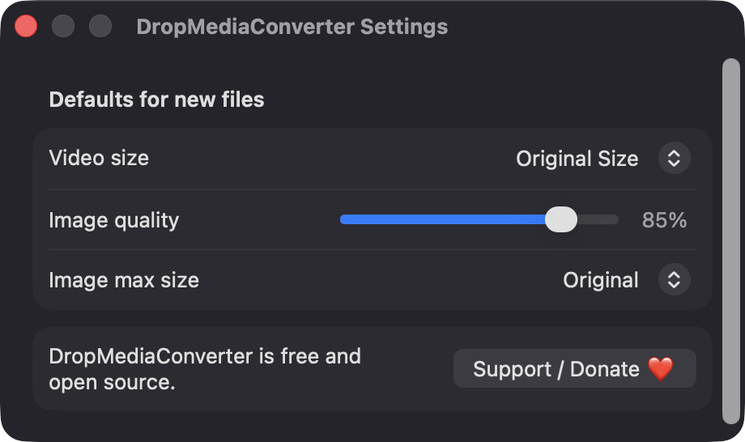
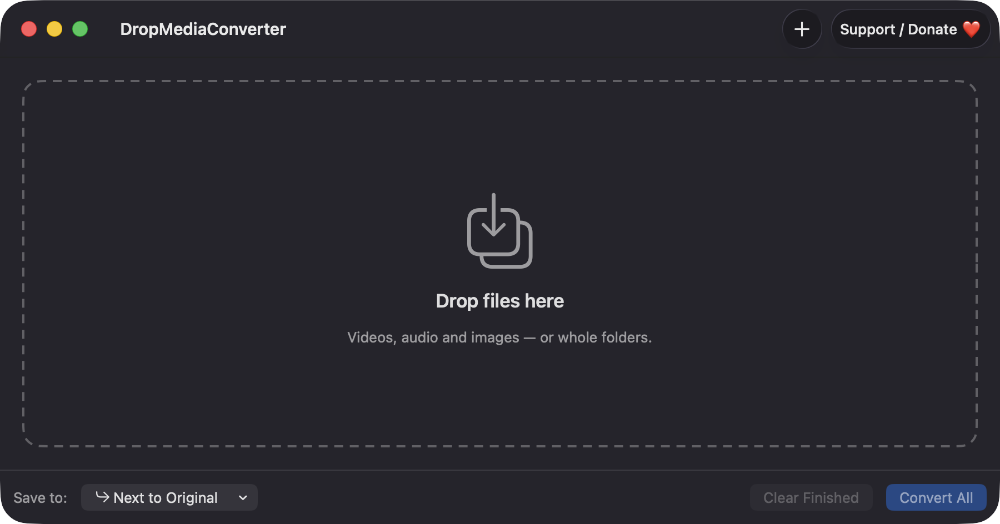

# DropMediaConverter

**🌐 Website:** [turhe123.github.io/drop-media-converter](https://turhe123.github.io/drop-media-converter/)

Drop videos, audio or images and convert them to common formats with simple presets and a progress list.


## Why

DropMediaConverter is a free, open-source, 100% native, backend-free alternative to paid utilities in the *Files & Conversion* category. It was inspired by the simple drag-and-drop workflow of Permute ($15 one-time): drop files in, pick a format, convert. Everything runs locally on your Mac using only Apple's system frameworks (AVFoundation and ImageIO), with no command-line tools to install.

## Features

- **Drag and drop** any number of files, or whole folders (expanded to the regular, non-hidden files inside). You can also use **Add Files…** (⌘O), or drop files on the Dock icon.
- **Per-row details**: thumbnail, file name, type, extension and size, plus a format picker that only offers outputs that make sense for that file.
- **Video output**: MP4 (H.264), MP4 (HEVC) and MOV, with size presets of 1080p, 720p and Original Size. HEVC offers 1080p and Original Size only, because AVFoundation has no 720p HEVC preset.
- **Audio output**: M4A (AAC), WAV (16-bit PCM) and AIFF (16-bit PCM). Videos with an audio track can also be extracted to these audio formats.
- **Image output**: JPEG, PNG, HEIC and TIFF, with a quality slider (for lossy formats) and an optional maximum dimension (512, 1024, 1600, 2048 or 4096 px).
- **Per-row settings popover** for the video preset or the image quality and size.
- **Preferences** (⌘,) for the defaults applied to newly added files: video size, image quality and image max size.
- **Convert All** (⌘↩) runs the queue with up to 2 conversions at a time, with a progress bar and a Cancel button per row, and a Reveal button in Finder when a row finishes.
- **Safe output**: files are saved next to the original or in a folder you choose. Existing files are never overwritten; a counter is added instead (`name.mp4`, `name 2.mp4`, …).
- **Clear errors**: failures appear as red text on the row. Unsupported codecs, files with no audio track, protected (DRM) media and low disk space are reported with a reason instead of crashing.
- **Clean cancel**: cancelling or failing removes any partial output file.
- **Clear Finished** removes completed and cancelled rows from the list.
- **Support / Donate ❤️** button in the toolbar, Settings and Help menu.

## Screenshots

<p align="center"></p>

<p align="center"><em>A mixed queue of audio, video and images converting side by side, with a live progress bar, Cancel, and Reveal buttons for finished files.</em></p>

<p align="center"></p>

<p align="center"><em>Settings set the default video size, image quality and maximum image size applied to newly added files.</em></p>

<p align="center"></p>

<p align="center"><em>The empty window is one big drop zone: drag in videos, audio, images or whole folders to start.</em></p>

## Install

1. Download `DropMediaConverter-macOS.zip` from the [latest release](https://github.com/turhe123/drop-media-converter/releases/latest).
2. Unzip it and move `DropMediaConverter.app` to `/Applications`.
3. Because the app is open source and not notarized, remove the quarantine attribute:

   ```bash
   xattr -cr /Applications/DropMediaConverter.app
   ```

4. Right-click the app and choose **Open** the first time.

Requires macOS 14.0 or later (Apple Silicon and Intel).

## Build from source

Requires Xcode and [XcodeGen](https://github.com/yonaskolb/XcodeGen).

```bash
brew install xcodegen
xcodegen generate
xcodebuild -project DropMediaConverter.xcodeproj -scheme DropMediaConverter -configuration Release -derivedDataPath ./build build
```

The app is produced at `build/Build/Products/Release/DropMediaConverter.app`.

## Permissions

DropMediaConverter does not request any special system permissions. In particular, it does **not** ask for Accessibility, Screen Recording or Microphone access, and it never records or captures anything.

- **Files and folders**: the app is not sandboxed. It reads the files you drop on it or pick in the open panel, and writes the converted output next to the original or in the folder you choose. macOS may show the usual prompt if one of those locations is protected (for example Desktop, Documents, Downloads or removable volumes).
- **Network**: none. The app makes no network calls. The only outbound action is opening the Ko-fi page in your browser when you click the Support button.

## Built with AI

DropMediaConverter was written by [Claude Code](https://claude.com/claude-code) inside an automated pipeline, from a plain-English spec. No code, binaries or assets from any commercial app were used; it is a clean-room reimplementation of a feature set, not a copy.

What that means in practice:

- The full source is in this repo under the MIT license. Read it before you run it.
- No network calls, no analytics, no third-party dependencies. Only Apple frameworks.
- Ad-hoc signed and not notarized, which is why Gatekeeper warns on first launch.
- It has had less human review than a hand-written app. Bug reports and pull requests are welcome.

## Support ❤️

If this app saves you time, you can support its development:

[Support Or (Leo) Davidai ❤️ on Ko-fi](https://ko-fi.com/leodavidai)

## License

MIT © Or Davidai Bachar
